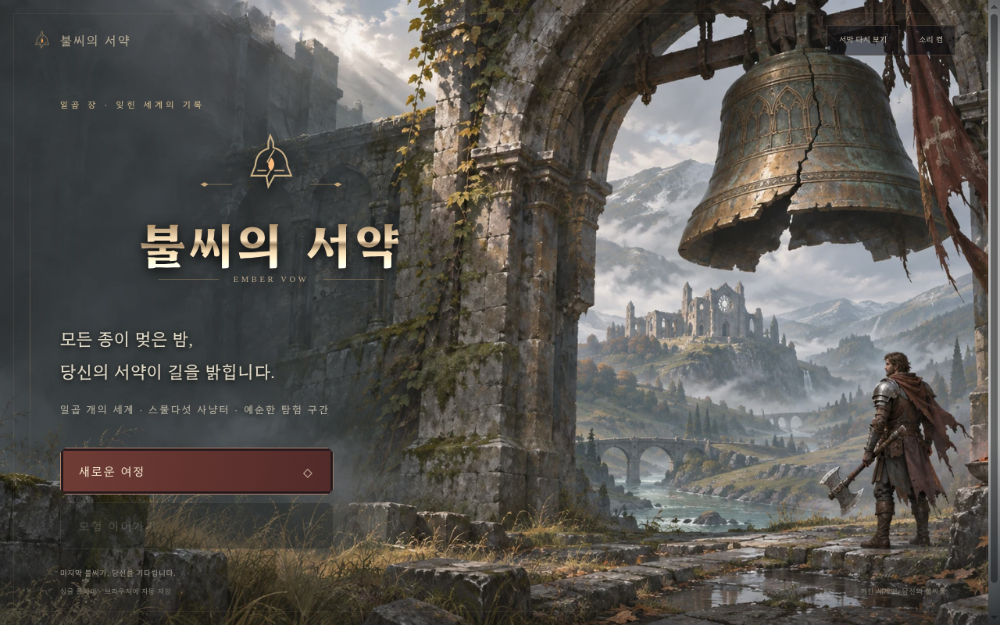
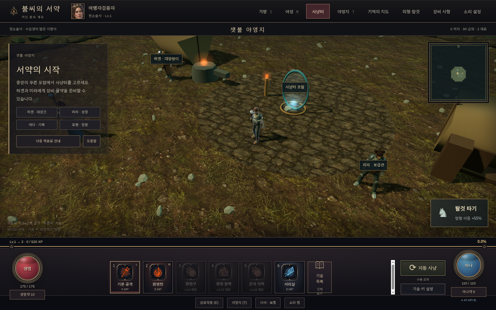
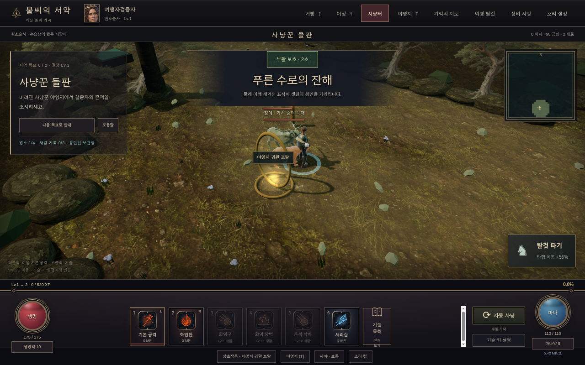
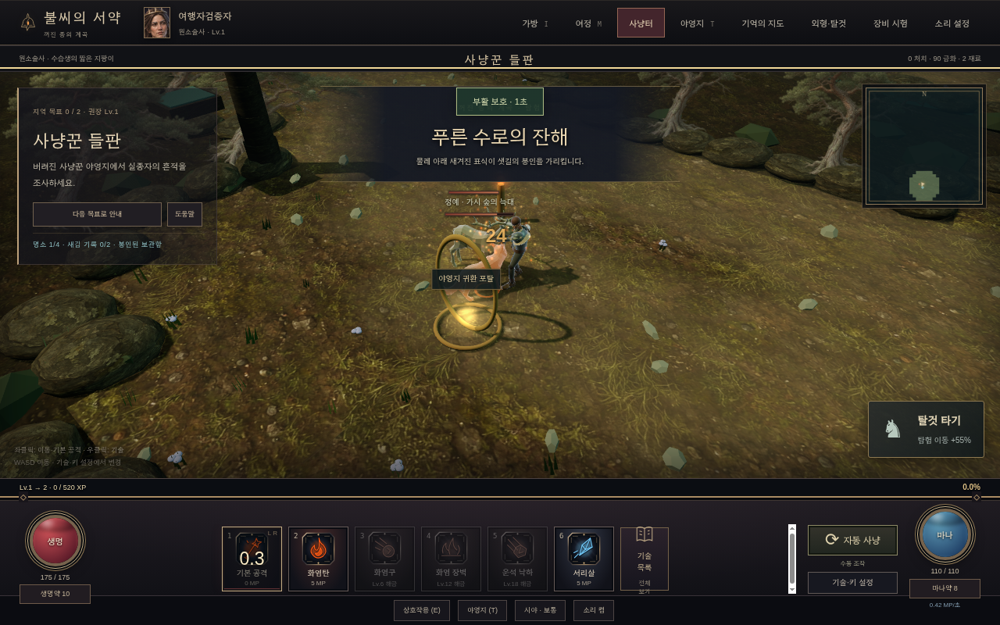

# 불씨의 서약 (이전·수정 배포본)

원작 웹 게임 **불씨의 서약(v16)** 을 원작자의 허락 조건 안에서 이 저장소로 이전하고, 음악·효과음을 교체한 뒤 GitHub Pages로 배포한 버전입니다.

- **플레이:** https://sigco3111.github.io/bulssi-seoyak/
- **원작:** https://readasesang-lab.vercel.app/v16/ (원작 게임: https://ember-vow-gamma.vercel.app)

## 소개

꺼진 종의 계곡을 무대로 한 3D 액션 RPG입니다. 캠프를 거점으로 포탈을 통해 사냥터로 나가 몬스터를 사냥하고, 장비와 탈것을 모으고, NPC와의 대화와 기록으로 이야기를 진행합니다. 싱글 플레이이며 진행 상황은 브라우저에 자동 저장됩니다.

## 주요 특징

- Three.js 기반 실시간 3D 필드와 전투 (기본 공격 + 스킬 6슬롯, MP 관리)
- 직업 선택(야만전사·원소술사·궁수·성기사)과 이름 짓기, 프롤로그 대화
- 포탈로 이동하는 다수의 사냥터 지역(권장 레벨별 해금)과 지역 보스
- NPC 대화·상점·보급, 퀘스트 목표와 기록 수집
- 장비·외형·탈것 수집, 가방/여정/지도 UI
- 장면(지역)별 배경 음악 전환과 전투 효과음, 소리 설정(전체/음악/효과음/환경 소리)

## 플레이 방법

1. 배포 링크를 열고 **새로운 여정**을 선택합니다.
2. 시네마틱은 `ESC`로 건너뛸 수 있습니다.
3. 직업을 고르고 이름을 입력한 뒤 **이 이름으로 시작**을 누릅니다.
4. 프롤로그 대화는 **계속**으로 진행하고, 야영지에서 **사냥터 포탈**로 사냥터에 진입합니다.
5. 이동은 `WASD`, 공격·스킬은 하단 단축키(`1`~`6`) 또는 버튼 클릭, 가방 `I`, 여정 `M`, 야영지 `T`.

## 스크린샷

| 타이틀 | 야영지(마을) |
| --- | --- |
|  |  |

| 사냥터 진입 | 전투 |
| --- | --- |
|  |  |

모든 스크린샷은 이 배포본을 직접 실행해 촬영했습니다.

## 실행과 배포

- 이 저장소는 빌드 결과물을 `docs/`에 두고 GitHub Pages(main 브랜치 `/docs`)로 배포합니다.
- 로컬에서 확인하려면 `docs/`를 정적 서버로 열면 됩니다. 예: `python3 -m http.server --directory docs 8000` 후 `http://localhost:8000` 접속.
- 소스 빌드: `node design/build.mjs --web --public` (esbuild 사용, 결과물은 `design/dist/web/`에 생성).

## 기술 상세

- **언어/구조:** 순수 JavaScript(ES2020), 빌드는 esbuild. `design/`(게임 데이터·빌드 스크립트), `presentation/`(UI·오디오·클라이언트), `assets/`(모델·그림·소리)로 나뉘어 있습니다.
- **렌더링:** Three.js(MIT). 캐릭터 모델·애니메이션은 Quaternius(CC0).
- **오디오:** Web Audio API. 배경 음악은 2채널 `<audio>` 플레이어를 교차 페이드로 전환하며 장면(지역/보스/타이틀)에 따라 트랙을 선택하고 반복 재생합니다. 효과음은 합성된 버퍼를 피치 변조와 함께 재생합니다.
- **웹 배포 최적화:** `--web` 빌드는 모델·그림·소리를 별도 파일로 분리해 처음 받는 양을 줄이고, 음악은 재생 시점에만 받습니다.
- **한글 폰트:** Hahmlet(SIL OFL 1.1) 워드마크 글리프 사용.

## 음악·효과음 크레딧

원작 음악·효과음은 원작자의 허락 범위 밖이라 이 배포본에는 포함하지 않습니다. 대신 아래와 같이 교체했습니다.

### 배경 음악 (OpenGameArt, CC0)

| 장면 | 곡 | 제작자 |
| --- | --- | --- |
| 타이틀 | Lament for a Warrior's Soul | Snabisch |
| 야영지 | The Old Tower Inn | AntumDeluge |
| 사냥꾼 들판 | Exploration 1 - Grasslands (JRPG Pack 1) | pebonius |
| 가라앉은 묘지 | Gothicvania Ghost Town | ansimuz |
| 가시울 숲 | Dark Theme | looneybits |
| 검은물 늪지 | Dark Forest Theme | josepharaoh99 |
| 바람칼 고개 | Determined Pursuit | Tozan |
| 광산 | Dungeon Ambience | Creomoto |
| 대성당 | Fantasy Choir 1 | Snabisch |
| 보스 | Boss Battle Theme (Variation) | CleytonRX |
| 최종 보스 | Boss Battle #2 (Symphonic Metal) | AntumDeluge |

모두 CC0로, 원 출처는 opengameart.org입니다. 음량은 -20 LUFS로 정규화해 mp3로 변환했습니다.

### 효과음

이 저장소에서 자체 합성한 파일로 교체했습니다(원작 효과음 아님).

## 원작 및 라이선스

- 원작: 불씨의 서약 v16 (readasesang-lab). 원작자는 README에서 코드·이름·이야기·그림의 자유로운 수정 사용을 허락했고, **그대로 다시 올려 파는 것**만 하지 말아 달라고 했습니다. 이 배포본은 그 조건을 따릅니다.
- 원작 음악은 "다시 배포하거나 돈을 받는 곳에 쓰기 전에 그 서비스의 이용 조건을 직접 확인"해야 한다는 원작자 안내에 따라 이 저장소와 배포에서 제외했습니다.
- Three.js MIT License, Quaternius CC0, Hahmlet SIL OFL 1.1 — 각 라이선스는 빌드 결과물의 주석에도 포함됩니다.
